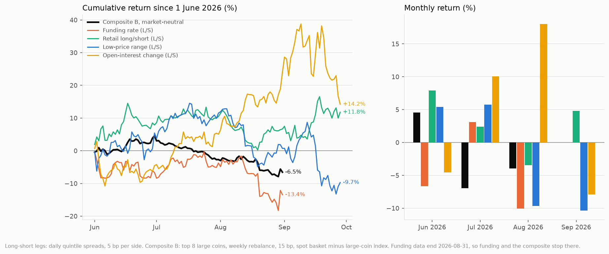

# Equity Microstructure Factors in Crypto: Funding Rates and Positioning

**Question.** Do the factors of a sell-side market-microstructure series written for
China A-shares (Kaiyuan Securities, *Market Microstructure Research*, reports 1–32) carry
over to crypto, where minute bars, taker-side order flow and perpetual-futures data are
free?

**Answer, in one line.** The data wall disappears, but most factors do not travel. The
signals that held up are the ones A-shares do not have — the perpetual **funding rate**
and **retail positioning** — plus a low-price **range** factor, and they pay only in a
market-neutral form (spot long basket, perpetual index short). After publication the
combination returned +4.6% in June 2026, −6.9% in July and −4.0% in August (−6.5% over
the three months), so it has not made money out of sample so far.

Evidence grade: **backtest and out-of-sample backtest** (association). Nothing here is
live trading or investment advice.

## Data

| Item | Source |
|---|---|
| Spot and USDT-margined perpetual 1-minute klines, including taker-buy volume | Binance public dumps, `data.binance.vision` |
| Funding rates (monthly files), open interest and long/short ratios (daily) | `data.binance.vision` |
| Cross-exchange check: daily OHLCV and funding | OKX via `ccxt` |
| Panel | 105 coins × 730 days, 2024-06 to 2026-05 (extended to 873 days, through 2026-10-21, in the updates) |

Raw data are not in this repository; `binance_pipeline.py`, `perp_pipeline.py`,
`fetch_okx.py` and `update_data.py` download them.

**Backtest conventions.** Daily cross-sectional quintile long–short, stated cost 5 bp per
side; about five names per leg in the large-coin pool; 365-day annualization. Positions
are filled at the same daily close (00:00 UTC) that completes the signal, with no
execution lag. Robustness checks: two-halves split, parameter sensitivity, rolling
windows and the OKX cross-exchange replication.

> **Cost erratum (2026-10-26).** Every long–short figure in this README, `README_zh.md`
> and the dated reports was computed with a formula that charged the *average* of the
> two legs' turnover instead of their sum, i.e. about **2.5 bp per side, not the stated
> 5 bp**. The composite overlays in the v2.0 section were also charged nothing for
> re-weighting. The code now charges 5 bp per side on the traded notional of both legs
> and of the overlays (`src/crypto_factors/costs.py`, `tests/test_cost_accounting.py`).
> The factor tables have **not** been regenerated: that needs the raw Binance panels,
> which are not in this repository or in the public Hugging Face dataset (it holds only
> the aggregated `data/results/` tables). Until then, read the long–short Sharpe ratios
> below as upper bounds. Long-only lines and the weekly spot basket of the deliverable
> composite were charged correctly.

## Results (report of 2026-06-19, data through 2026-05-31; long–short costs under-charged, see erratum)

| Factor | Type | 730-day Sharpe | Out-of-sample checks | Verdict |
|---|---|---|---|---|
| Funding rate | perpetual | +1.42 | both halves positive; parameter-stable; 91% of rolling windows positive; same sign on OKX | strongest |
| Retail long/short ratio | perpetual | +1.39 | both halves positive; parameter-stable | robust |
| Low-price range | price | +1.63 | both halves positive; most parameter-stable; same sign on OKX | robust (bear-market defensive) |
| Large taker buys | order flow | +0.73 | both halves positive, parameter-fragile | low confidence |
| "Ideal" reversal | price | +0.25 | both halves positive, parameter-fragile | low confidence |
| Cross-sectional momentum | price | −0.38 | both halves negative | does not transfer |

Other findings recorded in [`reports/REPORT.md`](reports/REPORT.md):

- **Short samples manufacture factors.** The best factors on a 120-day window
  (Sharpe +3.50 and +1.93) turned negative on 730 days.
- **Each factor has its own best universe breadth**; taker-flow factors are unstable
  across pools (Sharpe 0.73 / 0.10 / 1.62), funding is strong in all three.
- **Fade the "top traders".** Following Binance's top-trader long/short ratio loses
  (Sharpe −1.36).
- **Constrained optimization helps by dropping bad factors, not by fine weighting**:
  with only good factors, 1/N beats mean–variance; with bad ones mixed in, constrained
  max-Sharpe wins by setting them to zero (Sharpe 0.39 → 0.89).
- **83% of the funding factor's return is price reversal and 17% carry.**

**Deliverable composite** (`deploy_spot.py`): z-score of funding + retail ratio + range,
top 8 large coins, equal weight, weekly rebalance.

| Form | NAV | Sharpe | Max drawdown | Weekly turnover |
|---|---|---|---|---|
| Spot long only | 0.59 | −0.54 | −56% | 5% |
| Spot long + perpetual index short (market-neutral) | 1.35 | +1.18 | −11% | 5% |

The hedged row subtracts an equal-weight index and charges nothing on the short side.
The 2026-10 audit ([`reports/LIVE_READINESS_AUDIT_2026-10.md`](reports/LIVE_READINESS_AUDIT_2026-10.md)
§3, 537 days through 2026-10-20, 1-minute entry delay) rebuilt it with tradable hedges:
Sharpe **0.81** with a 24-perpetual equal-weight short (funding accrual and rebalance fees
included) and **−0.03** with a BTC/ETH 50/50 perpetual short, against 0.86 for the ideal
index over the same window. This is a research result, not a trading recommendation.

## After publication

The factors are cross-sectional ranks with no fitted parameters, so every day after
2026-05-31 is out of sample.

| Update | Window | Market-neutral composite | What changed |
|---|---|---|---|
| [`reports/UPDATE_2026-07.md`](reports/UPDATE_2026-07.md) | June 2026 (30 days) | **+4.6%**, max drawdown −2.0% | Funding reversed in the June sell-off (new-window Sharpe −1.76; its short leg failed); retail ratio and range strengthened |
| [`reports/UPDATE_2026-08.md`](reports/UPDATE_2026-08.md) | July 2026 (31 days) | **−6.9%**, max drawdown −5.6% | Range and retail ratio turned negative; open-interest change became the strongest factor year to date |
| [`reports/UPDATE_2026-09.md`](reports/UPDATE_2026-09.md) | August 2026 (31 days); single factors through 2026-09-28 | **−4.0%** | Altcoins rallied (+21% in August, +35% in September); funding's short leg failed again (−10.1% in August); range lost in both months |
| [`reports/UPDATE_2026-10.md`](reports/UPDATE_2026-10.md) | September 2026 (30 days) + October MTD through 2026-10-21 (`fwd_ret` through 10-20) | **+1.47%** (Sep) / **+2.70%** (Oct MTD), **+4.21%** over 50d since 08-31 | Funding (+5.10% in Sep, +3.38% Oct MTD, +12.05% pure long-only excess over 50d) and retail ratio (+2.82% Sep, +8.73% Oct MTD, +6.66% over 09-29..10-20) recovered strongly; v2.0 `inv_vol_funding_gated_voltarget_15pct` gained +1.59% (MaxDD -1.31%) over 09-29..10-20 |



Over June–August (92 days) the composite returned **−6.5%** with a maximum drawdown of
−11.9%, slightly deeper than the −11.5% of its whole pre-publication backtest (515 days).
Of its three components, only the retail ratio is positive since publication (+11.8%
long–short through September); funding is −13.4%, almost all of it from the short leg
(its long leg alone is +5.7%), and range is −9.7%. September's funding file is published
in early October, so the composite stops at 2026-08-31. The recipe has not been re-fitted:
re-weighting on four months of data would be fitting to noise.

A data note: Binance's QNT and SAGA perpetuals made one-sided moves in late September
(QNT closed at about 5× its OKX price), so September figures for the broad-universe
factors are unreliable; the large-coin factors and the composite do not include these
coins. Major-coin closes match OKX within 0.04%.

One to four months of data say little about Sharpe ratios; the updates report cumulative
returns and day counts instead.

### v2.0 785-day composite overlays (`data/results/equity_perp.csv`): superseded headline

These rows combine the daily net returns (2024-06-03 to 2026-07-27) of the three surviving
perpetual-futures factors (`低价位振幅`, `资金费率`, `散户多空比`). **They overstate
performance and are kept only as the published record**:

- The three factor NAVs carry the under-charged long–short cost (about 2.5 bp per side).
- The published overlay rows charged nothing when the inverse-vol weights, the funding
  gate or the vol-target leverage (up to 1.5×) changed the allocation.
- Selection is in-sample. The core factors, their universes and the gate constants
  (20-day inverse-vol window, 5-day funding trigger at −1.5%, 0.25× scale) were chosen
  on a window that overlaps 728 of the 785 days, and the funding-squeeze gate was added
  on 2026-10-22, after the June–August 2026 squeeze it dampens had been observed and
  published. Only the last 57 days postdate the 2026-05-31 cutoff, and they are not
  independent of the gate's design.
- The Benjamini–Hochberg FDR step in `pipeline.py` runs only on the 10-date sample fixture
  (`data/fixtures/sample_perp_panel.csv`); no multiple-testing adjustment covers these
  strategies.

As published (`reports/real_785d_perp_validation.csv`, no overlay cost):

| Strategy | 785d Cum Return (%) | 785d Sharpe | 785d Max DD (%) | Calmar | NW $t$-stat | Pre-Pub 728d Sharpe |
|---|---:|---:|---:|---:|---:|---:|
| `static_equal_weight` | +150.75 | 1.87 | -16.26 | 3.28 | 2.95 | 1.89 |
| `volatility_targeted_15pct` | +91.00 | 1.85 | -12.54 | 2.80 | 2.79 | 1.91 |
| `inv_vol_funding_squeeze_gated` | +163.88 | 2.19 | -14.88 | 3.83 | 3.23 | 2.23 |
| `inv_vol_funding_gated_voltarget_15pct` | +96.95 | 2.12 | -8.55 | 4.33 | 3.13 | 2.18 |

Overlay re-weighting charged at 5 bp per side on |Δ allocation| × gross exposure, on the
same published factor NAVs (`evaluate_real_785d_perp_nav()` in `pipeline.py`, the default
since 2026-10-26; still upper bounds because the factor NAVs are under-charged):

| Strategy | 785d Cum Return (%) | 785d Sharpe | 785d Max DD (%) | Calmar | Overlay cost (%/yr) |
|---|---:|---:|---:|---:|---:|
| `static_equal_weight` | +150.75 | 1.87 | -16.26 | 3.28 | 0.00 |
| `volatility_targeted_15pct` | +86.41 | 1.79 | -12.83 | 2.62 | 1.13 |
| `inv_vol_funding_squeeze_gated` | +147.52 | 2.05 | -14.93 | 3.51 | 2.98 |
| `inv_vol_funding_gated_voltarget_15pct` | +86.57 | 1.96 | -9.25 | 3.64 | 2.52 |

The repository's own stress test of `inv_vol_funding_gated_voltarget_15pct`
([`reports/LIVE_READINESS_AUDIT_2026-10.md`](reports/LIVE_READINESS_AUDIT_2026-10.md) §2,
`reports/live_readiness_2026_10/v2_composite_delay_cost_stress.csv`, 835 days through
2026-10-20) is the most conservative published reading of this strategy:

| Execution | Cost (bp) | 835d Cum (%) | 835d Sharpe | 835d Max DD (%) |
|---|---:|---:|---:|---:|
| Close of the signal day | 5 | +72.34 | 1.48 | -14.32 |
| 1-minute delay (00:01 UTC) | 5 | +70.76 | 1.46 | -15.13 |
| 1-minute delay (00:01 UTC) | 15 | +53.14 | 1.18 | -15.83 |
| 1-minute delay (00:01 UTC) | 30 | +28.26 | 0.72 | -18.39 |
| 1-minute delay (00:01 UTC) | 50 | +1.14 | 0.11 | -24.83 |
| Next-day close | 15 | +54.92 | 1.23 | -14.79 |

The script that produced the audit is not committed and its cost convention ("bp per
trade") is not documented, so it cannot be reproduced from this repository either; at
5 bp it already sits well below the 1.69 that `reports/latest_oos_2026_10_composite.csv`
reports for the same 835 days. Recomputing all of the above with the corrected cost
formula is pending access to the raw panels.

## Limitations

- Fills at the same daily close that completes the signal (no execution lag), no market
  impact, equal weights within quintiles, about five names per leg in the large-coin pool.
  The 2026-10 audit reruns the main signals with 1-minute, 12-hour and next-day delays.
- Published long–short tables under-charge costs (about 2.5 bp instead of 5 bp per
  side; see the erratum above) and have not yet been regenerated.
- The 2024–26 sample is an altcoin bear market; part of the range factor's Sharpe is
  bear-market defence.
- OKX funding history via `ccxt` reaches back only about three months, so the
  cross-exchange check is short.
- Capturing the funding factor requires perpetual shorts (margin, liquidation, funding
  accrual).

## Reproduce

```bash
pip install ccxt pandas pyarrow scipy matplotlib
python binance_pipeline.py      # spot dumps
python perp_pipeline.py all     # perpetuals, funding, open interest
python backtest_perp.py         # factor backtests by universe breadth
python backtest_real.py         # funding accrual, long-only and decomposition
python oos_validate.py          # split-sample, parameter and rolling checks
python oos_okx.py               # OKX cross-exchange check
python deploy_spot.py           # deliverable composite
python update_data.py all && python report_postpub.py   # post-publication windows and months
python make_charts_postpub.py                           # equity_postpub.png
```

`live_monitor.py` serves a local dashboard (`dashboard.html`, preview in
`dashboard_preview.png`) that marks the composite to OKX prices.

## Files

The research write-ups are in Chinese: [`README_zh.md`](README_zh.md) (full detail),
[`reports/REPORT.md`](reports/REPORT.md), [`reports/UPDATE_2026-07.md`](reports/UPDATE_2026-07.md),
[`reports/UPDATE_2026-08.md`](reports/UPDATE_2026-08.md), [`reports/UPDATE_2026-09.md`](reports/UPDATE_2026-09.md) and [`reports/UPDATE_2026-10.md`](reports/UPDATE_2026-10.md); the cost, delay and hedge stress tests are in [`reports/LIVE_READINESS_AUDIT_2026-10.md`](reports/LIVE_READINESS_AUDIT_2026-10.md). Result tables are in `data/results/` and `reports/`; figures are in `reports/figures/`.

Research period: June–September 2026. Source series: Kaiyuan Securities (开源证券)
financial-engineering *Market Microstructure Research* series; the reports themselves
are not redistributed here.
